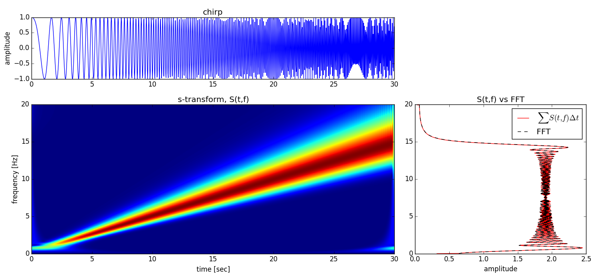
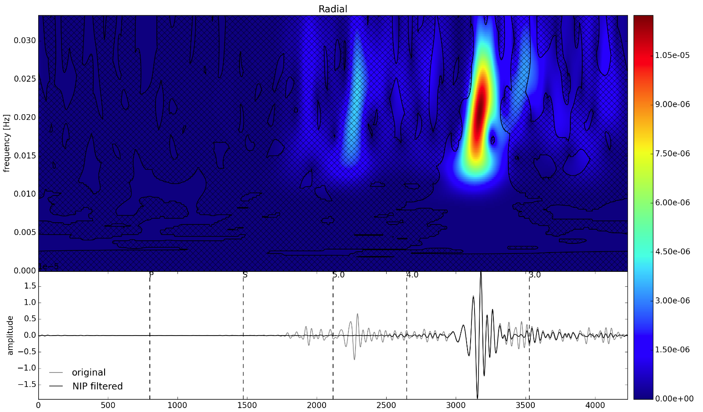

# Particle Man

**Particle** **m**otion **an**alysis of seismic surface waves using the Stockwell Transform.

[](https://www.gnu.org/licenses/old-licenses/gpl-2.0.en.html)


* [Documentation](https://lanl-seismoacoustics.github.io/particleman)

Seismic surface waves can be detected and extracted from three-component
data through particle motion polarization analysis.  Particle Man is a
software package that employs the Stockwell Transform to perform surface wave
filtering/extraction and display for multifrequency analysis.


This package implements the Normalized Inner Product surface wave filtering and extraction methods of
[Meza-Fajardo et al., (2015)](https://pubs.geoscienceworld.org/ssa/bssa/article/105/1/210/323461/identification-and-extraction-of-surface-waves).






## Installation

### Simple Installation (v0.4.0+)

As of version 0.4.0, Particle Man uses the external [stockwell](https://github.com/claudiodsf/stockwell) library, which provides pre-built wheels. No C compiler or FFTW installation required!

```bash
pip install particleman
```

### Using Conda

```bash
conda install -c conda-forge particleman
```

### From Source

```bash
git clone https://github.com/LANL-Seismoacoustics/particleman.git
cd particleman
pip install .
```

### Legacy Installation (v0.3.0 and earlier)

Older versions required a C compiler and FFTW libraries. If you need the old version:

**Prerequisites:**
* C compiler
* fftw3

**Dependencies:**
* Python 3
* NumPy
* Matplotlib

On macOS: `brew install fftw` or `conda install -c conda-forge fftw`

On Linux: `apt-get install libfftw3-dev` (Debian/Ubuntu) or equivalent

## New in v0.4.0

### Enhanced Time-Frequency Resolution Control

The Stockwell transform now supports gamma parameter tuning:

```python
from particleman import stransform

# Standard transform (gamma=1.0, default)
S = stransform(data, Fs=100)

# Better time resolution (gamma < 1)
S = stransform(data, Fs=100, gamma=0.5)

# Better frequency resolution (gamma > 1)
S = stransform(data, Fs=100, gamma=2.0)
```

### Alternative Window Functions

Choose between Gaussian (default) and Kazemi window functions:

```python
# Standard Gaussian window
S = stransform(data, Fs=100, win_type='gauss')

# Kazemi window
S = stransform(data, Fs=100, win_type='kazemi')
```

### Deprecation Notice

⚠️ **Low-level API Deprecation**: Direct use of `particleman.st.st()` and `particleman.st.ist()` is deprecated.

```python
# Deprecated (will be removed in future version):
from particleman.st import st, ist

# Use instead:
from stockwell.st import st, ist

# Or use the high-level API (recommended, not deprecated):
from particleman import stransform, istransform
```

The high-level functions `stransform()` and `istransform()` are **not deprecated** and remain the recommended way to use the Stockwell transform in particleman.
